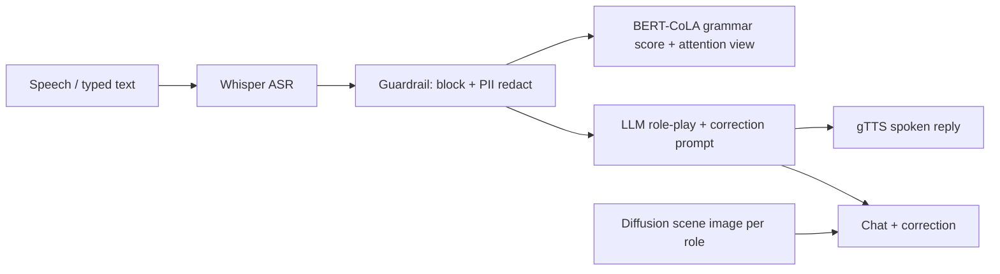

# Spoken English Practice Partner (P28)

Role-play spoken conversations (Interviewer / Shopkeeper / Friend) and get gentle grammar corrections.
Generative AI CA mini-project, MIT School of Computing, Pune.

**Live app:** <ADD HUGGING FACE SPACE URL>  |  **Demo video:** <ADD LINK>

## Pipeline


## Five unit layers
| Unit | Where in this repo |
|---|---|
| U1 Foundations | Role prompts + zero-shot vs few-shot toggle (`core.py`); BERT-CoLA probability per sentence |
| U2 GANs & LLM | Transformer LLM dialogue with correction instructions; prompt-based vs fine-tuned (CoLA) comparison in `eval_prompting.py`; attention heatmap in the app |
| U3 GPT, BERT, multimodal | GPT-style LLM + BERT (CoLA) + Whisper (audio) |
| U4 Tools & generation | PyTorch/Transformers throughout; diffusion scene images (`generate_scenes.py`); TTS replies |
| U5 Responsible AI | `eval_accents.py` (accent WER), false-correction test, guardrail + PII redaction, no recordings stored, `MODEL_CARD.md` |

## Run locally
```bash
pip install -r requirements.txt        # also needs ffmpeg installed
export GROQ_API_KEY=...                # optional; without it a small local Qwen model is used (slower, weaker)
python app.py
python eval_prompting.py && python eval_accents.py
python generate_scenes.py              # once, on a GPU; commit assets/*.png
```

## Deploy (Hugging Face Spaces)
Create a Gradio Space, push these files, and add `GROQ_API_KEY` under Settings → Secrets. `packages.txt` installs ffmpeg.
Never commit keys or recordings.
